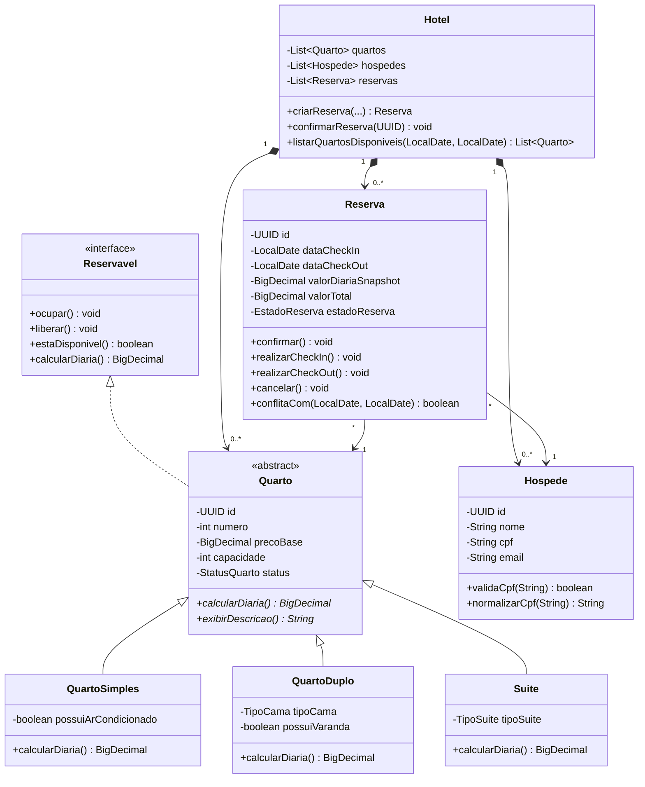
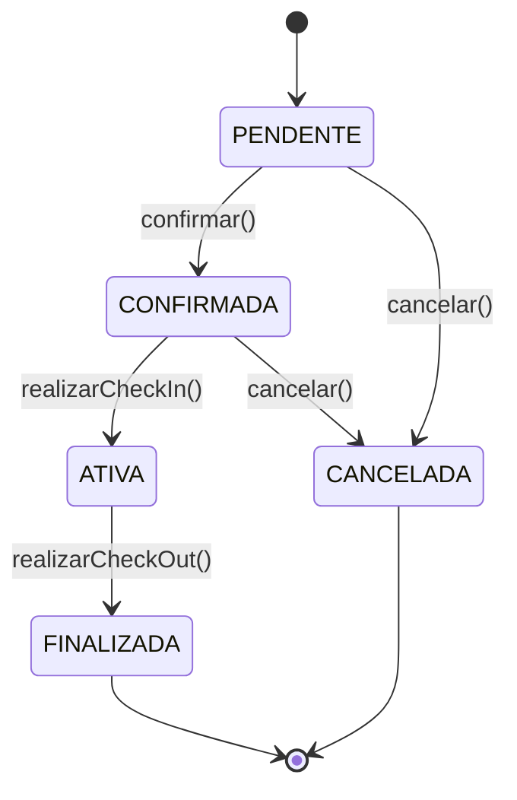

# Sunland Hotel Manager (`legacy-java` — v1.0-java)

Versão **Legacy Java** consolidada do **Sunland Hotel Manager** (sistema de gerenciamento hoteleiro orientado a objetos), refatorada com **Java 21**, **Maven**, **JUnit 5** e **JaCoCo** antes da evolução principal do projeto para **Python + API REST** na branch `Main`.

---

## Melhorias Aplicadas na Versão `v1.0-java`

- **Build e Estrutura Padrão Maven (`com.sunland.hotel`):** gerenciamento de dependências, compilação Java 21, suíte JUnit 5, relatório de cobertura JaCoCo e geração de Javadoc sob demanda (`target/site/apidocs`).
- **Modelagem com Enums de Domínio:** substituição de strings mágicas por `StatusQuarto`, `TipoCama`, `TipoSuite` e `EstadoReserva` (com parsing case-insensitive).
- **Precisão Financeira e Snapshot:** uso de `BigDecimal` (`RoundingMode.HALF_UP`, escala 2) em todas as diárias e congelamento do valor (`valorDiariaSnapshot` e `valorTotal`) na criação da reserva.
- **Agenda por Intervalo de Datas (`LocalDate`):** reservas usam `dataCheckIn` e `dataCheckOut`, permitindo consultar disponibilidade por período (`[checkIn, checkOut)`) sem conflitos em check-out/check-in no mesmo dia.
- **Prevenção de Overbooking:** revalidação de conflitos de agenda durante a confirmação de reservas pendentes (`ConflitoReservaException`).
- **Validação Real de Hóspedes:** validação dos dígitos verificadores do CPF (módulo 11 + rejeição de dígitos repetidos), normalização de CPF (11 dígitos), unicidade de CPF e número de quarto, e validação estrita de e-mail.
- **Integridade e Encapsulamento:** códigos/UUIDs únicos por entidade, bloqueio de exclusão insegura de hóspedes/quartos/reservas em aberto e listas imutáveis nos getters do `Hotel`.
- **Testes Automatizados:** 55 testes unitários e de regra de negócio com **JUnit 5** (`HospedeTest`, `QuartoTest`, `ReservaTest`, `HotelTest`) e cobertura >85% nos pacotes de domínio via **JaCoCo**.

---

## Requisitos

- **Java JDK 21**
- **Apache Maven 3.9+**

---

## Como Executar e Testar

### Rodar os testes JUnit 5 e gerar relatório JaCoCo
```bash
mvn clean test jacoco:report
```
O relatório HTML de cobertura é gerado em `target/site/jacoco/index.html`.

### Executar a aplicação CLI
```bash
mvn -q compile exec:java
```

### Gerar Javadoc sob demanda
```bash
mvn javadoc:javadoc
```
A documentação é gerada em `target/site/apidocs/index.html`.

---

## Arquitetura de Domínio



### Ciclo de Estados da Reserva



---

Projeto base desenvolvido originalmente para fins acadêmicos por **Emanuel Victor Barros Bezerra** e consolidado na versão `v1.0-java`.
